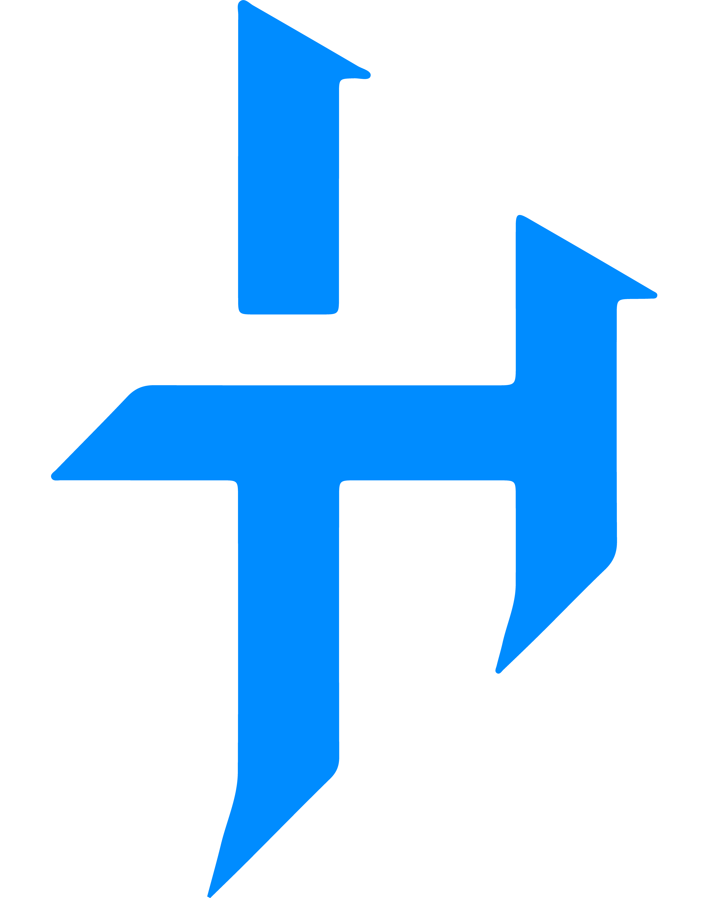

  

<h3><code>&gt; whoami</code></h3>

<pre>
const henrique = {
  role: "full stack dev",
  degree: "B.Sc. Computer Science ✅",
  rn: ["shipping web apps", "messing with Three.js", "making games nobody asked for"],
  offline: ["video games 🎮", "puzzles 🧩"],
  vibe: "if it works, don't touch it",
};
</pre>

 

<h3><code>&gt; stack</code></h3>

   
   
  

<h3><code>&gt; ping</code></h3>

  
  
  

<h3><code>&gt; contributions</code></h3>

<picture>
  <source media="(prefers-color-scheme: dark)" srcset="https://raw.githubusercontent.com/henrick1/henrick1/output/github-snake-dark.svg" />
  
</picture>

